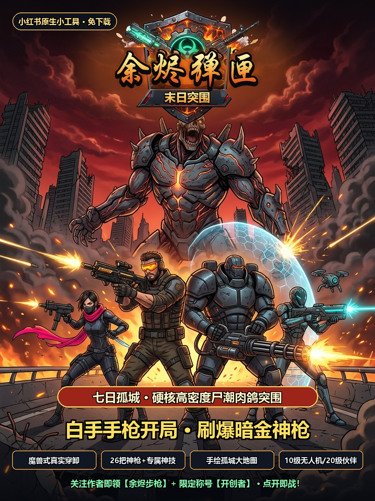
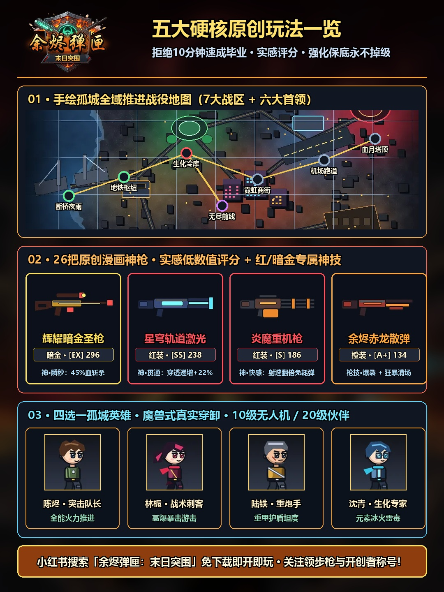

# 《余烬弹匣：末日突围》小红书原生小工具 & 宣发物料仓库

> **七日孤城 · 硬核高密度尸潮肉鸽突围**（100% 纯原创小红书小工具游戏 · 免下载即开即玩）

<p align="center">
  
  
</p>

---

## 一、仓库目录结构

| 路径 | 说明 |
| :--- | :--- |
| [`minitool/`](./minitool/) | 小红书小工具完整前端源码（`index.html`、`styles.css`、`data.js`、`engine.js`、`renderer.js`、`audio.js` 及 `assets/` 高清精灵、枪械、地图与音效） |
| [`ember-magazine-minitool.zip`](./ember-magazine-minitool.zip) | 可直接上传小红书专业号 / 创服平台的小工具发行包（`1.948 MiB < 2.00 MiB`，根目录直含 `index.html`） |
| [`promo/promo_cover_3x4.jpg`](./promo/promo_cover_3x4.jpg) | 小红书 `3:4` 高清竖版主封面宣传图（`1080×1440`） |
| [`promo/promo_features_3x4.jpg`](./promo/promo_features_3x4.jpg) | 小红书 `3:4` 五大原创硬核玩法卖点长图（`1080×1440`） |
| [`promo/promo_trailer_xhs.mp4`](./promo/promo_trailer_xhs.mp4) | 小红书 `3:4` 酷炫实机机制混剪宣传视频（`18s` H.264 + 原声 BGM / 爆炸与升级音效混音） |
| [`promo/xiaohongshu_copywriting.md`](./promo/xiaohongshu_copywriting.md) | 小红书爆款笔记宣发文案包（5 组爆款标题、正文排版、置顶首评引导与高流量标签） |

---

## 二、核心原创系统架构亮点

1. **实感低数值评分与双维对比（`[D]` → `[EX]`）**
   - 摒弃动辄几千几万的虚高战力，武器基础评分紧缩控制在 `10 ~ 320` 区间，综合评分从新手 `~12 [D]` 稳步成长至毕业 `~480 [EX]`。
   - 装备库支持与当前主枪实时横向对比，直观展示绿色 `▲+` / 红色 `▼-` 属性差值及战术定位标签（`均衡突击`、`穿透清屏`、`高甲斩首`、`爆破击飞` 等）。
2. **枪械技能与红/暗金专属神技**
   - 26 把独立漫画造型神枪，7 档品质分级克制光效（白/绿/蓝纯哑光、紫微光、橙流光扫掠、红脉动余烬、暗金双流光、`+15` 满级金冠光环）。
   - 蓝/紫/橙枪自带枪械被动（如【弹夹回收】【穿透增幅】【尸爆溅射】），红装与暗金神武额外觉醒专属神技（【神·快感】射速翻倍免耗弹、【神·瞬秒】斩杀、【神·贯通】穿透递增伤害）。
3. **魔兽式全身真实穿卸 + 防具/头盔/核心流派被动**
   - 新用户开局从四位幸存者（陈烬 / 林栀 / 陆铁 / 沈青）中四选一永久锁定，仅持一把制式小手枪白手起家。
   - 打怪掉落的头盔、防弹战甲、火控核心（首饰）穿戴后在中央舞台与局内战斗角色身上**真实分层穿卸可见**，并附带冰/火/雷/毒元素注入及绝境无敌、反伤、穿透棱镜等实战被动。
4. **强化保底祝福（只升等级、不改品质、永不掉级）**
   - 强化 `+0 → +15` 仅提升等级与基础属性，绝不改变品质；`+6` 起未成功不掉级并累积祝福值，满 `100%` 下次必成！同时支持老神枪同步追平当前账号等级。
5. **经典防毕业稀缺掉率 + 手绘孤城全域推进战役地图**
   - 严格控制高阶橙/红/暗金掉率，无尽模式按波次阶梯解禁高阶品质（`1~5波` 最高蓝、`6~12波` 解禁紫/橙、`13~20波` 解禁红、`21波+` 解禁暗金），彻底杜绝 10 分钟速成毕业。
   - 搭载手绘俯视孤城全域战略地图（`world_campaign_map.webp`），包含 SVG 战术推进路线、已收复绿旗、红光雷达前线与底部即时出击简报。
6. **双线成长 + 重工军需商店（战功点）**
   - 局内肉鸽三选一翻牌升级 vs 局外独立账号经验等级；账号 `Lv.10` 解锁 4 款浮游无人机、`Lv.20` 从其余三位英雄中招募专属白板伙伴并肩作战。
   - 重工支援（浮游无人机与破晓战车底盘改装）不靠打怪免费掉落，需通过通关与斩杀首领积攒【战功点】在重工军需商店购置。

---

## 三、本地预览与小红书模拟器调试

```bash
# 方式 1：使用小红书官方 redapp CLI 启动模拟器工作台
redapp dev --dir ./minitool

# 方式 2：使用任意静态 HTTP 服务直接预览
python -m http.server 8770 --bind 127.0.0.1 -d ./minitool
```
